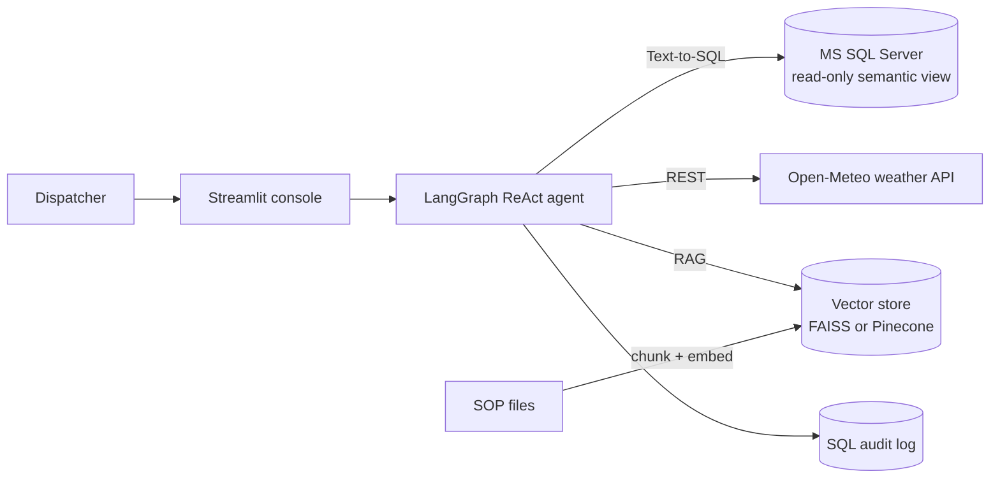

# 🧊 Cold-Chain Logistics AI Agent

An agentic AI dispatch assistant for refrigerated freight. A dispatcher asks a question in plain English, for example *"Are any shipments near Los Angeles breaking the temperature rules?"*, and the agent queries live fleet telemetry, checks real-time weather, looks up the company's Standard Operating Procedures (SOPs), and replies with an action plan that cites the exact SOP rule.

It is built as a Forward Deployed Engineering exercise: a legacy SQL Server system with no API, operating rules scattered across documents, and an AI layer added **without** giving the model write access to production data.

## The problem

Cold-chain spoilage is expensive, and when a reefer truck runs warm, dispatchers lose time:

- Telemetry sits in a **legacy MS SQL Server** with cryptic column names (`IOT_TEMP_VAL_C`, `PRT_CNG_LVL`) and no API.
- Escalation and mitigation rules live in **SOP files** (MD, PDF, CSV, XLSX) that have to be searched by hand.
- External factors such as weather and port congestion have to be checked separately.

## How it works



The agent runs a **reasoner → tools → reasoner** loop (LangGraph `StateGraph` with a `ToolNode` and conversation memory) and decides which of its three tools to call:

| Tool | What it does |
|---|---|
| `query_telemetry_db` | Writes and runs a T-SQL `SELECT` against the `FDE_VIEWS.VW_ACTIVE_FLEET` view |
| `fetch_corridor_conditions` | Fetches live temperature and wind for a GPS point from Open-Meteo |
| `search_compliance_sop` | Retrieves the most relevant SOP passages from the vector store |

The system prompt routes questions in two ways. **Policy questions** ("what is a Tier 2 escalation?") use only the SOP search and get a short answer. **Incident questions** use all three tools and get a structured report: executive summary, telemetry table and an SOP-cited action plan.

## Guardrails

- **Least-privilege database access.** The agent connects as `USR_FDE_RO`, which can only `SELECT` from a clean semantic view and is explicitly denied the raw legacy table and any write on `dbo`. A prompt-injected `DROP TABLE` has nothing to act on.
- **Semantic view layer.** `VW_ACTIVE_FLEET` renames legacy columns to readable names, so the model writes better SQL and never sees the raw schema.
- **Audit trail.** Every tool call, its inputs, its outputs and every final answer is written to `FDE_VIEWS.AgentAuditLog`, viewable from an admin page in the UI.
- **Grounded answers.** The prompt only allows SOP rules and numbers that appear in tool results, and tells the model to say when the SOP doesn't define something.

## Tech stack

**Agent:** LangGraph, LangChain, tool calling · **LLMs:** OpenAI GPT-4o, DeepSeek, or local Qwen 2.5 7B via Ollama · **Retrieval:** BGE-M3 or OpenAI embeddings, FAISS or Pinecone · **Data:** Microsoft SQL Server 2022 in Docker, SQLAlchemy + pyodbc · **UI:** Streamlit · **Deploy:** AWS EC2, systemd, GitHub Actions

## Project structure

```
scripts/
  ingest_legacy_data.py          # load the CSV into SQL Server under legacy column names
  setup_security_and_view.sql    # semantic view + read-only agent login
  ingest_sop_pinecone.py         # chunk + embed SOP files into FAISS or Pinecone (hash-cached)
src/
  agent_tools.py                 # the three agent tools
  orchestrator.py                # LangGraph agent and LLM selection
  ui.py                          # Streamlit dispatch console + audit log viewer
  prompts/system_prompt.txt      # routing, SQL and grounding rules
data/
  raw/                           # Kaggle supply-chain telemetry dataset
  policy/                        # SOP documents
docs/instrutions.md              # original phase-by-phase walkthrough (incl. EC2 deployment)
```

## Run it locally (Windows)

**You need:** Python 3.12+, Docker Desktop, [ODBC Driver 18 for SQL Server](https://learn.microsoft.com/en-us/sql/connect/odbc/download-odbc-driver-for-sql-server), and either [Ollama](https://ollama.com/download) (free, local) or an OpenAI/DeepSeek API key.

1. **Start SQL Server**
   ```powershell
   docker run -v mssql_data:/var/opt/mssql -e "ACCEPT_EULA=Y" -e "MSSQL_SA_PASSWORD=FdeEnterprisePass123!" -p 1433:1433 --name legacy-mssql -d mcr.microsoft.com/mssql/server:2022-latest
   ```
2. **Install dependencies**
   ```powershell
   python -m venv .venv
   .\.venv\Scripts\pip install -r requirements.txt
   ```
3. **Create `.env`** in the project root:
   ```ini
   SQL_SERVER_HOST=localhost
   SQL_SERVER_PORT=1433
   SQL_ADMIN_USER=sa
   SQL_ADMIN_PASSWORD=FdeEnterprisePass123!
   SQL_AGENT_USER=USR_FDE_RO
   SQL_AGENT_PASSWORD=AgentPassword2026!

   Agent_llm=OLLAMA            # OLLAMA | OPENAI | DEEPSEEK
   OPENAI_API_KEY=
   DEEPSEEK_API_KEY=

   Embeddings_model=LOCAL      # LOCAL (BAAI/bge-m3) | OPENAI
   Local_Embedding_Model=BAAI/bge-m3

   VECTOR_DB=FAISS             # FAISS (local) | PINECONE
   PINECONE_API_KEY=
   ```
   For Ollama, also run `ollama pull qwen2.5:7b`.
4. **Load the data and lock down the database**
   ```powershell
   .\.venv\Scripts\python scripts\ingest_legacy_data.py
   ```
   Then run `scripts/setup_security_and_view.sql` as `sa`, plus the `AgentAuditLog` table from Phase 4 of [docs/instrutions.md](docs/instrutions.md).
5. **Index the SOPs**
   ```powershell
   .\.venv\Scripts\python scripts\ingest_sop_pinecone.py
   ```
6. **Launch the console**
   ```powershell
   .\.venv\Scripts\streamlit run src\ui.py
   ```

The demo passwords above come from the original tutorial and are for local use only. Change them for anything shared.

## Test scenarios

| Scenario | Prompt | Expected behaviour |
|---|---|---|
| **Domino effect** | *Find any active shipments near Los Angeles (Lat ~33.8, Lon ~-118.1). Check the local weather, and tell me if the cargo temperature violates the SOP for fresh perishables.* | Calls all three tools in order and flags the breach (>4.0 °C) with the SOP mitigation steps |
| **Restraint** | *Can you quickly explain the difference between a Tier 1 and Tier 2 escalation?* | Calls only the SOP search; no database or weather calls |

**Results with local Qwen 2.5 7B:** the Domino test passes: correct location query, real breach found (36.66 °C, High Risk), real SOP citation. The Restraint test routes correctly, but the model still invents a Tier 1 definition that the SOP never states. Larger models (GPT-4o, DeepSeek) follow the grounding rule more reliably.

## What I changed from the original tutorial

- **Pluggable vector store.** Added a `VECTOR_DB` switch so SOP retrieval runs on local FAISS without a Pinecone account; Pinecone stays fully supported.
- **Fixed the local-LLM path.** `ChatOllama` had been removed from `langchain_community`, so Ollama mode crashed on import; it now uses `langchain-ollama`.
- **System prompt reaches the UI.** The prompt was only sent by the CLI loop, so the Streamlit console ran without it. The orchestrator now injects it for every conversation.
- **Prompt rewritten after failure analysis.** Added policy-vs-incident routing, T-SQL location rules (the model was writing reversed `BETWEEN` bounds and returning nothing), and grounding rules against invented SOP citations.

## Credits

Based on the Forward Deployed Engineer tutorial project by [nimowhyca](https://github.com/nimowhyca/cold-chain-logistics-FDE-Project). Telemetry data from the Kaggle [Logistics and Supply Chain Dataset](https://www.kaggle.com/datasets/datasetengineer/logistics-and-supply-chain-dataset).
